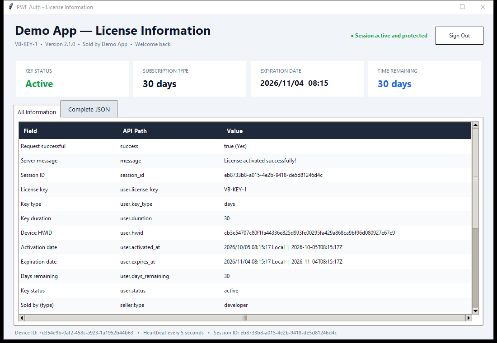
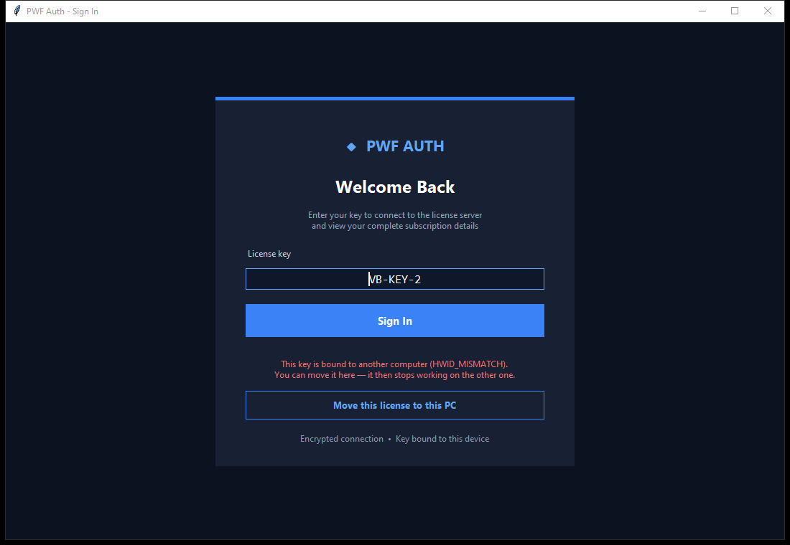

# PWF Auth Python Desktop Sample

This revision uses `pwfauth` **1.5.0**. The requirements file installs the PyPI wheel, pinned by version and SHA-256. Versions before 1.3.0 cannot talk to the current server (it signs its replies with a new key), so update older copies.

An English Tkinter desktop client for the official
[`pwfauth` Python package](https://pypi.org/project/pwfauth/) (version 1.5.0).
The application:

- signs in with a license key;
- keeps the session alive with the background heartbeat;
- signs out when the server ends the session;
- shows the complete login response in a dashboard;
- keeps a value on the server for the key (a user variable).



## What it shows

- **Sign in with a license key.** `login()` binds the key to this computer. The
  dashboard then shows:
  - the key's status, type, expiry and time left;
  - who sold the key;
  - every field of the reply.
- **The kill switch.** `start_heartbeat()` runs after sign-in. When you ban, pause
  or reset the key in your dashboard, or it expires, the package calls
  `on_session_ended`, and the app returns to the sign-in page with the reason.
  - The callback runs on the heartbeat thread. The app hands it to the Tkinter
    thread through a queue, because Tkinter must only be used from its own thread.
  - Moving the PC clock does not dodge it. The package corrects a wrong clock by
    itself, and a server that keeps refusing the clock ends the session.
- **Move a license to a new PC.** When the key is bound to another computer, the
  sign-in page offers **Move this license to this PC**. This uses
  `reset_hardware_id()`, then signs in again. The developer's cooldown applies
  between two moves (12 hours by default).

  

- **User variables.** After sign-in the app reads `sample_opens`, adds one and
  saves it with `get_variable()` / `set_variable()`, shows "Opened N times with
  this key" under the title, and lists every variable of the key
  (`get_variables()`) in the details table. Open the key in your panel
  (**Licences → the key → Variables**): the count is there, and a value you
  change there is what the app reads next time. Variables follow the key to a
  new PC.
- **Clear errors.** The app shows a plain message when:
  - there is no internet connection;
  - the server refuses the application secret (HTTP 401);
  - a reply claims success without encryption, so it did not come from the license
    server (a proxy, a hosts-file entry or a fake server);
  - the secret in `app.py` is still the placeholder.
- **Clean sign-out.** **Sign Out** and closing the window both end the session on
  the server right away.

## Requirements

- Windows 10 or later
- Python 3.9 or later, with Tkinter (included in the python.org installer)

## Configure

Set your 64-character application secret near the top of `app.py`:

```python
APP_SECRET = "YOUR_64_CHARACTER_APP_SECRET"
```

Configure this before distribution and never commit the real secret. The endpoint is fixed to `https://pwfauth.com`; environment overrides are ignored.

## Run

Double-click `run.bat`. The first run creates `.venv` and installs the package.
Or run:

```powershell
.\.venv\Scripts\python.exe app.py
```

Upgrading from an older copy of this sample? `run.bat` brings an existing `.venv`
up to `requirements.txt`, so `pwfauth` 1.5.0 replaces the older version. Without `run.bat`:

```powershell
.\.venv\Scripts\python.exe -m pip install -r requirements.txt
```

Network work runs outside the Tkinter thread, so the window never freezes while the
server answers.
